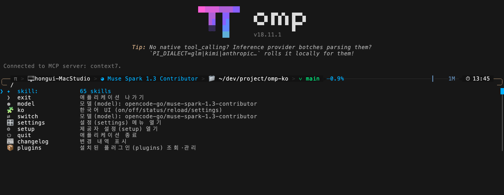
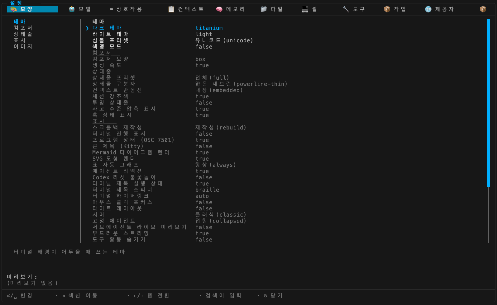

# omp-i18n-ko

[](https://www.npmjs.com/package/omp-i18n-ko) [](https://github.com/allbegray/omp-i18n-ko/actions/workflows/test.yml)

[omp(oh-my-pi)](https://omp.sh) 코딩 에이전트를 위한 **한국어 UI 언어팩** 확장입니다. omp **공식 확장 API만** 사용하며, 호스트 패치·포크·dist 수정을 하지 않습니다.

핵심 원칙:

- **CLI를 절대 깨뜨리지 않습니다.** 모든 경로가 예외 격리 + 영어 폴백이라, 언어팩 데이터가 잘못돼도 omp는 평소처럼 동작합니다.
- **실행 식별자는 번역하지 않습니다.** 커맨드 이름(`/settings`, `/model`), 모델 id, MCP·SSH·LSP 같은 식별자는 항상 영어 그대로라 그대로 입력할 수 있습니다.
- **명령/기능 키워드는 병기합니다.** 번역문 속 기능 키워드는 `한국어(english)` 형식입니다 — 예: `설정(settings) 메뉴 열기`. 한국어로 읽으면서도 원래 커맨드가 무엇인지 바로 알 수 있습니다.

## 스크린샷

**`/` 슬래시 메뉴** — 커맨드 설명이 한국어로:



**`/settings` 설정 패널** — 제목·탭·섹션·푸터·설정 라벨·설명까지 한국어 (실제 omp v18.11.1 TUI 캡처):



## 설치

한 줄 설치 (npm):

```bash
omp install omp-i18n-ko
```

omp를 재시작하면 `/` 메뉴가 한국어로 표시됩니다. 기본값은 **켜짐**입니다.

```bash
omp plugin list                    # 설치 확인
omp plugin upgrade omp-i18n-ko     # 업데이트
omp plugin uninstall omp-i18n-ko   # 제거 (omp 재시작 후 반영)
```

### 개발판 설치 (git)

npm 릴리스보다 최신 main을 쓰고 싶다면:

```bash
git clone https://github.com/allbegray/omp-i18n-ko.git ~/omp-i18n-ko && omp install ~/omp-i18n-ko
cd ~/omp-i18n-ko && git pull       # 업데이트 → omp 재시작 후 반영
```

설치 없이 한 번만 로드하려면 `omp -e ~/omp-i18n-ko/src/index.ts`. `omp install`을 쓸 수 없는 구버전 omp라면 수동 심링크(`ln -sfn ~/omp-i18n-ko/src/index.ts ~/.omp/agent/extensions/omp-i18n-ko.ts`)도 됩니다.

npm판·개발판·심링크를 동시에 걸면 중복 로드되므로 **한 가지만** 사용하세요.

## 사용법

| 명령 | 동작 |
| --- | --- |
| `/ko` · `/ko toggle` | 켜기 ↔ 끄기 |
| `/ko on` | 켜기 |
| `/ko off` | 끄기 (영어 원문 표시) |
| `/ko status` | 현재 상태 · 로드된 번역 항목 수 · 설정 패널 상태 |
| `/ko reload` | `translations.json`·`ko-data` 다시 로드 (편집 후 즉시 반영) |
| `/ko settings` | 한국어 설정 패널 열기 (내장 `/settings`와 같은 화면) |

토글 직후에는 이미 그려진 메뉴가 남을 수 있고, **다음 슬래시 메뉴 렌더부터** 반영됩니다(omp 확장 API에 강제 리페인트 훅이 없음). 평소처럼 **`/settings`를 입력해도** 한국어 설정 패널이 열립니다 — 확장이 꺼져 있거나 로드에 실패하면 내장 영어판이 그대로 동작합니다.

## 커버리지

커버 (omp v18.11.1 기준):

- 슬래시 커맨드 설명과 인자 자동완성 설명
- 선택 항목 상세(`nativeDetail`)와 동적 상태(`state`) — 예: `Plan: off` → `계획(plan): 꺼짐`
- 상태 문자열 패턴 — 예: `Tools: 12 active / 20 available` → `도구(tools): 12개 활성 / 20개 사용 가능`
- 작업 표시문 — `생각 중…` (`setWorkingMessage`)
- 설정 패널 — 제목·탭·섹션명·푸터·검색 배너와 전 탭 설정 라벨·설명·옵션까지 한국어

커버 불가 (omp 내부 제약): 커맨드 이름 자체, 팁 라인, 웰컴 마법사, 내장 상태줄 세그먼트, 호스트 알림.

## 설정 패널

`/ko settings`로 열거나, 평소처럼 **`/settings`를 입력**하면 같은 한국어 패널이 열립니다. omp 내장 컴포넌트(pi-tui `SettingsSelectorComponent`)에 한국어 데이터를 얹어 띄우는 방식이며, 재구현이 아닙니다.

- 값 변경(토글·숫자·경로·선택)은 omp의 정상 설정 스코프에 **그대로 저장**됩니다 — `/settings` 영문판과 동일하게 동작합니다.
- 번역 데이터는 `src/ko-data/`의 탭별 JSON입니다. 편집 후 `/ko reload`로 재적용하세요.
- 설정 라벨·설명은 `한국어(english)` 병기를 생략합니다(폭·가독성). Temperature·Top P·Top K·Min P 같은 관례적 영어 라벨은 영어 유지.
- 어느 단계든 실패하면 내장 영어 `/settings`가 그대로 동작합니다 — CLI는 영향을 받지 않습니다.

## 안전 설계

- 확장 로드·핸들러·번역 함수 전체가 `try/catch`로 격리됩니다 — 실패하면 영어 원문이 그대로 보일 뿐입니다.
- `translations.json`이 깨져도 **이전 번역을 유지**하고, 재시작 시에는 영어로 폴백합니다.
- omp가 업데이트되어 문구가 바뀌면 바뀐 항목만 자동으로 영어 폴백됩니다 — CLI는 영향받지 않습니다.
- `omp plugin uninstall omp-i18n-ko` + omp 재시작이면 흔적이 남지 않습니다.

## 번역 수정

`src/translations.json`(슬래시 메뉴)을 편집한 뒤 omp에서 `/ko reload`를 실행하세요. 설정 패널 문구는 `src/ko-data/*.json`(탭별 설정)과 `src/ko-data/chrome.json`(패널 크롬)에서 수정합니다.

매칭은 전부 **전체 문자열 매칭**이며, 부분 치환은 없습니다:

| 키 | 용도 |
| --- | --- |
| `exact` | 정적 설명문 전체 매칭 |
| `labels` | 동적 `Label: state` 문자열의 라벨 |
| `state` / `statePatterns` | 상태값 (고정값 / 정규식) |
| `suffixes` | 문자열 끝 접미사 — 예: ` (current)` → ` (현재)` |

기준 버전: **omp v18.11.1** (2026-10-15). 테스트: `bun test`.

## License

MIT. 소스·이슈: [GitHub](https://github.com/allbegray/omp-i18n-ko). 이 프로젝트는 [omp(oh-my-pi)](https://omp.sh)와 별개의 독립 확장이며, omp 팀과 무관합니다.
